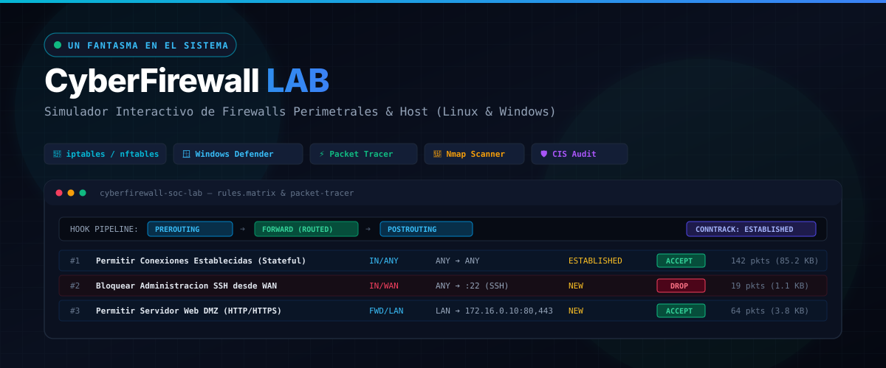
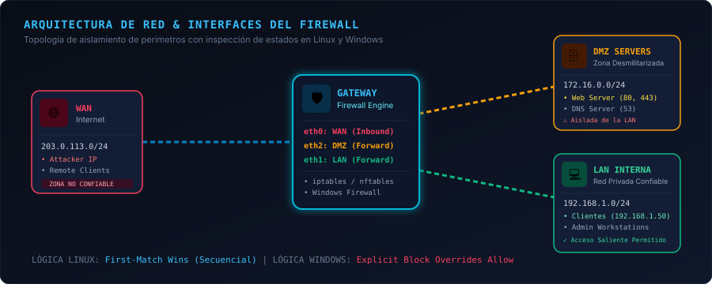
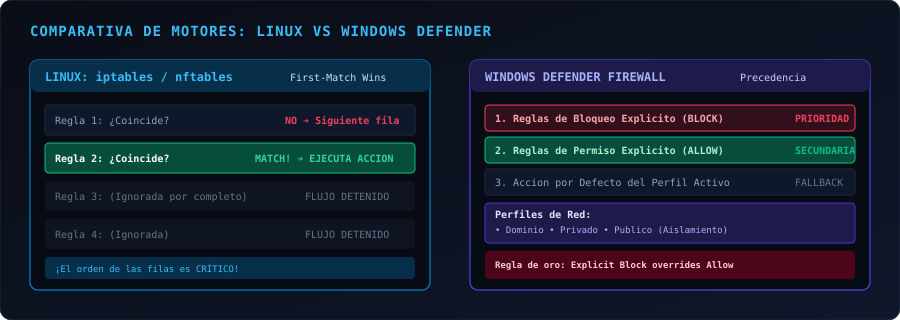

<p align="center">
  
</p>

<p align="center">
  <strong>Simulador interactivo de Firewalls perimetrales y de host para el aprendizaje práctico de la lógica de filtrado de paquetes en Linux (<code>iptables</code> / <code>nftables</code>) y Windows (<code>Windows Defender Firewall</code>).</strong>
</p>

<p align="center">
  <a href="https://www.unfantasmaenelsistema.com/"></a>
  
  
  
  
</p>

---

## 👻 Sobre el Autor

Desarrollado y mantenido por **[Un Fantasma en el Sistema](https://www.unfantasmaenelsistema.com/)**, plataforma dedicada a la divulgación de ciberseguridad práctica, hacking ético, laboratorios técnicos y análisis de sistemas.

* 🌐 **Sitio Web Oficial:** [https://www.unfantasmaenelsistema.com/](https://www.unfantasmaenelsistema.com/)
* 🛡️ **Enfoque:** Formación en ciberdefensa, análisis de redes, auditoría técnica y laboratorios interactivos sin barreras de entrada.

---

## 📌 ¿Por qué este simulador?

Comprender cómo un cortafuegos (*firewall*) toma decisiones ante el tráfico de red es una de las competencias más críticas en ciberseguridad, administración de sistemas y redes (CCNA, CompTIA Security+, LPIC, CISSP).

Sin embargo, los estudiantes y profesionales noveles suelen cometer errores conceptuales graves:
1. **La trampa del orden (*First-Match Trap*):** En Linux (`iptables`), una regla de bloqueo general (`DROP ALL`) colocada arriba anula cualquier regla permisiva posterior, aunque esté bien configurada.
2. **La ilusión del orden en Windows:** En Windows Defender Firewall, las reglas de bloqueo explícito (*Explicit Block*) tienen **prioridad absoluta** sobre las reglas de permiso (*Allow*), sin importar en qué orden se definan en la consola.
3. **La magia del estado (*Stateful Inspection*):** ¿Por qué un cliente interno puede navegar por Internet sin necesidad de abrir todos los puertos entrantes? Porque la tabla de estados (`conntrack`) permite automáticamente el tráfico de retorno `ESTABLISHED,RELATED`.
4. **La diferencia táctica entre DROP y REJECT:** Un `DROP` descarta silenciosamente el paquete (causando que un escaneo de Nmap se quede en timeout y muestre el puerto como `filtered`), mientras que un `REJECT` devuelve un paquete activo TCP RST o ICMP Unreachable (mostrando el puerto como `closed` de inmediato).

**CyberFirewall LAB** resuelve este problema mediante una experiencia interactiva paso a paso donde puedes fabricar paquetes, ver cómo viajan por la topología y observar qué regla gana.

---

## 📸 Arquitectura y Capturas de la Interfaz

### 1. Diagrama de Topología de Red y Pipeline Netfilter
La herramienta integra un mapa de red con las tres zonas habituales de una arquitectura corporativa (WAN no confiable, DMZ para servidores públicos y LAN privada):

<p align="center">
  
</p>

* **WAN (`eth0`):** Red externa no confiable (`203.0.113.0/24`).
* **Firewall Appliance / Host:** Gateway perimetral con motor de inspección.
* **DMZ (`eth2`):** Servidores Web (`172.16.0.10:80/443`) y DNS (`53`), aislados de la red interna.
* **LAN (`eth1`):** Estaciones de trabajo internas (`192.168.1.0/24`).
* **Pipeline Netfilter Hooks:** Muestra el recorrido exacto del paquete:
  $$\text{PREROUTING} \longrightarrow \text{Decisión Enrutamiento} \longrightarrow \begin{cases} \text{INPUT} & \text{(Servicios locales del firewall)} \\ \text{FORWARD} & \text{(Tráfico enrutado hacia DMZ o LAN)} \end{cases} \longrightarrow \text{OUTPUT} \longrightarrow \text{POSTROUTING}$$

---

### 2. Comparativa de Motores: Linux vs Windows Defender

<p align="center">
  
</p>

| Característica | Linux (`iptables` / `nftables`) | Windows Defender Firewall |
| :--- | :--- | :--- |
| **Principio de Evaluación** | **First Match Wins** (Secuencial estricto) | **Precedencia de Bloqueo** (*Block overrides Allow*) |
| **Impacto del Orden Físico** | **Crítico:** La primera regla que coincide detiene el flujo | **Ninguno:** Las reglas de bloqueo siempre se evalúan primero |
| **Perfiles de Red** | Mediante interfaces de red (`eth0`, `eth1`, `tun0`) | Perfiles dinámicos: **Dominio**, **Privado**, **Público** |
| **Inspección de Estados** | Módulo de kernel `conntrack` (`NEW, ESTABLISHED, RELATED`) | Motor de inspección de estado de Windows (`WFP`) |
| **Herramientas de Configuración** | `iptables`, `nftables`, `ufw`, `firewalld` | `New-NetFirewallRule` (PowerShell), `netsh advfirewall` |

---

## 🚀 Características Principales

### 🎯 1. Matriz de Reglas Dinámica con Detección de Reglas Sombreadas
* Tabla de reglas interactiva con botones **▲ / ▼** para reordenar y observar en vivo el impacto del orden secuencial.
* **Detección automática de *Shadowed Rules*:** Si una regla superior anula a una regla posterior (haciéndola inalcanzable), el sistema la destaca con una etiqueta ámbar `[SOMBREADA]`.
* **Contadores de Tráfico en Tiempo Real:** Registra paquetes (`pkts`) y bytes (`B / KB`) acumulados por cada regla, emulando la salida de `iptables -v -L -n`.
* Botón **`0 pkts`** para resetear contadores (`iptables -Z`).

### 📦 2. Inyector y Trazador de Paquetes (Packet Tracer)
* Fabricador visual de paquetes: define Dirección (`INBOUND`, `OUTBOUND`, `FORWARD`), Zona (`WAN`, `LAN`, `DMZ`), Protocolo L4 (`TCP`, `UDP`, `ICMP`), IPs/Puertos origen y destino, banderas TCP y estado conntrack (`NEW`, `ESTABLISHED`, `RELATED`).
* **Presets con 1 Clic:**
  * Tráfico Web de cliente LAN a servidor DMZ (`SYN / NEW`).
  * Ataque SSH desde WAN a puerto 22.
  * Respuesta Web legítima (`ACK / ESTABLISHED`).
  * Sondeo sigiloso nmap SYN a puertos cerrados.
  * Ping ICMP Echo Request.
* **Botón ⇄ Retorno:** Intercambia IPs y puertos y conmuta el estado a `ESTABLISHED` para evidenciar cómo la regla genérica de retorno permite la vuelta sin abrir puertos entrantes adicionales.

### 🔬 3. Inspector Profundo Wireshark y Hexdump
* Accordion interactivo que disecciona cada campo del paquete generado:
  * **Frame Ethernet II:** Direcciones MAC física origen y destino, EtherType `0x0800`.
  * **IPv4 Header:** Version, Header Length, Total Length, TTL, Checksum y Protocolo.
  * **TCP/UDP Segment:** Puertos, Sequence Number, Flags (`SYN`, `ACK`, `RST`) y Window Size.
  * **Hexdump Crudo:** Volcado hexadecimal en bloques de 16 bytes con representación ASCII en tiempo real.

### 💻 4. Traductor CLI Multi-Plataforma en Tiempo Real
Genera scripts reales y listos para producción sincronizados con cualquier cambio en la tabla de reglas:
* **Linux clásico:** Script ejecutable `bash` con comandos `iptables -A`, políticas por defecto `iptables -P` y cadenas de limpieza `iptables -F`.
* **Linux moderno:** Sintaxis `nftables` con tablas `inet filter`, prioridades y hooks.
* **Windows PowerShell:** Cmdlets `New-NetFirewallRule` y `Set-NetFirewallProfile`.
* **Windows CMD:** Comandos clásicos `netsh advfirewall firewall add rule`.
* Botón de copiado con confirmación interactiva.

### 🛰️ 5. Simulador de Escaneo Nmap Integrado
* Simula escaneos de reconocimiento de puertos directamente contra el firewall:
  * `-sS` *(TCP SYN Stealth / Half-Open)*
  * `-sT` *(TCP Connect 3-Way Handshake)*
  * `-sA` *(TCP ACK / Mapeo de reglas y detección de firewalls stateful)*
  * `-sU` *(UDP Scan)*
* Salida idéntica al terminal de Nmap 7.94 clasificando puertos en:
  * `open`: Servicio accesible.
  * `filtered`: Paquete descartado con **`DROP`** (tiempo de espera agotado, ocultando la topología).
  * `closed`: Paquete rechazado con **`REJECT`** (recibe paquete TCP RST o ICMP Port Unreachable al instante).

### 🛡️ 6. Auditor de Seguridad y Hardening CIS / PCI-DSS
* Motor de auditoría automatizado que analiza el conjunto de reglas frente a estándares de seguridad reconocidos (*CIS Linux Benchmark*, *PCI-DSS v4.0*):
  * Comprueba si la política por defecto es restrictiva (`DROP`).
  * Comprueba la presencia y posición de la regla de retorno `ESTABLISHED,RELATED`.
  * Identifica reglas muertas o sombreadas (*Shadowed Rules*).
  * Advierte sobre puertos críticos administrativos (SSH 22, RDP 3389, Telnet 23) expuestos a `ANY` (`0.0.0.0/0`).
  * Asigna una puntuación de hardening (`0 a 100/100`) y un grado (`A+`, `A`, `B`, `C`, `F`) con recomendaciones de mitigación.

### 🎮 7. Retos y Desafíos Guiados (Laboratorio Hands-On)
* **Reto 1: Aislamiento de DMZ:** Asegura que la LAN pueda consumir el servidor Web DMZ pero bloquea cualquier intento de que un servidor DMZ comprometido inicie conexiones hacia la LAN interna, verificando el retorno por conntrack.
* **Reto 2: First-Match Trap:** Un administrador novato colocó una regla `DROP ALL TCP` arriba del puerto 80. Corrige el problema reordenando con los botones ▲/▼ sin eliminar reglas.
* **Reto 3: Precedencia de Bloqueo en Windows:** Demuestra empíricamente cómo una regla de bloqueo en Windows tiene precedencia sobre una de permiso sin importar su posición física en la lista.
* Botón **"Comprobar Solución"** con inyección automatizada de paquetes de prueba y feedback didáctico.

### 🔄 8. Tabla NAT / PAT (SNAT & MASQUERADE Engine)
* **Visualización de Traducción de Direcciones:** Nueva pestaña dedicada en la consola de logs que mapea en tiempo real las IPs y puertos privados de LAN hacia la dirección pública WAN del firewall (`203.0.113.1`).
* **Visualización del Hook `POSTROUTING`:** Muestra la transformación exacta del paquete cuando es aceptado en modo `FORWARD` o desde `LAN`:
  $$\text{LAN } 192.168.1.50:51200 \xrightarrow{\text{SNAT MASQUERADE}} \text{WAN } 203.0.113.1:61420 \longrightarrow \text{DST } 172.16.0.10:80$$
* **Simulación de de-NATting en Retorno:** El botón de tráfico inverso detecta la sesión activa y simula la recepción en la IP pública WAN y su de-translación automática hacia el host privado por conntrack.
* **Exportación CLI de Reglas NAT:** Genera automáticamente las reglas de `iptables -t nat -A POSTROUTING -o eth0 -j MASQUERADE` y de `nftables` asociadas.

### 🔊 9. Audio Sintetizado de Terminal SOC
* Generador de sonido nativo mediante **Web Audio API** (sin dependencias externas ni archivos de audio pesados):
  * Chime armónico de éxito para `ACCEPT`.
  * Golpe sordo de sub-bajo (*thud*) para `DROP`.
  * Alerta de zumbido para `REJECT`.
  * Pulso de radar para el barrido de Nmap.
  * Botón **🔊/🔇** para activar o silenciar con un clic.

---

## 📂 Estructura del Repositorio

```text
cyberfirewall-lab/
├── index.html                     # Aplicación completa autónoma (HTML5, Tailwind CDN, Vanilla JS)
├── metadata.json                  # Metadatos del applet y configuración
├── package.json                   # Dependencias para desarrollo local opcional
├── vite.config.ts                 # Configuración de servidor de desarrollo Vite
├── tsconfig.json                  # Configuración TypeScript
├── LICENSE                        # Licencia Apache 2.0
├── README.md                      # Documentación completa y guía educativa
└── public/
    └── assets/
        ├── cyberfirewall_banner.svg   # Banner oficial del repositorio
        ├── topology_diagram.svg       # Diagrama de arquitectura de red
        ├── evaluation_logic.svg       # Diagrama comparativo Linux vs Windows
        └── aistudio/
            └── icono_81a3db5b.png     # Logotipo de Un Fantasma en el Sistema
```

---

## ⚡ Instalación y Puesta en Marcha

### Opción 1: Ejecución Directa (Sin dependencias ni instalación)
La aplicación fue diseñada bajo la filosofía **Zero-Install / Single-File**:
1. Descarga el archivo `index.html`.
2. Haz doble clic sobre `index.html` para abrirlo en cualquier navegador web moderno (Chrome, Firefox, Safari, Edge, Brave, Opera).
3. ¡Listo! Todo el motor de cálculo CIDR, la animación de paquetes y el generador de comandos funcionan de forma 100% nativa y offline en el cliente.

### Opción 2: Servidor Local con Node.js / Vite
Si deseas ejecutarlo mediante un entorno de desarrollo web:

```bash
# 1. Clonar el repositorio
git clone https://github.com/tu-usuario/cyberfirewall-lab.git
cd cyberfirewall-lab

# 2. Instalar dependencias
npm install

# 3. Iniciar el servidor de desarrollo
npm run dev

# 4. Abrir en el navegador en http://localhost:3000
```

### Opción 3: Servidor Rápido con Python
```bash
# En el directorio del proyecto:
python3 -m http.server 8080
# Abrir en http://localhost:8080
```

### Opción 4: Despliegue en GitHub Pages
1. Ve a **Settings > Pages** en tu repositorio de GitHub.
2. En **Build and deployment > Source**, selecciona **Deploy from a branch**.
3. Selecciona la rama `main` y la carpeta `/ (root)`.
4. En cuestión de segundos, tu laboratorio estará disponible públicamente en `https://tu-usuario.github.io/cyberfirewall-lab/`.

---

## 🧠 Fundamentos Teóricos de Ciberseguridad

### Cálculo Binario de Subredes CIDR
Los firewalls de red operan a nivel binario para evaluar si una dirección IP pertenece a una regla con prefijo CIDR:

$$\text{¿Coincide?} = (\text{IP\_Objetivo} \ \ \& \ \ \text{Máscara}) == (\text{Subred\_Regla} \ \ \& \ \ \text{Máscara})$$

* Para `192.168.1.0/24`:
  * Máscara binaria: `255.255.255.0` $\rightarrow$ `11111111.11111111.11111111.00000000`
  * Si la IP es `192.168.1.45`, la operación `AND` binaria resulta en `192.168.1.0`.
  * Dado que coincide exactamente con la red especificada, el criterio es **MATCH**.
* En el simulador puedes usar la **Calculadora CIDR** integrada en la barra superior para ver esta comparación bit a bit en tiempo real.

---

## 📄 Licencia

Este proyecto está bajo la Licencia **Apache 2.0** - Consulta el archivo [LICENSE](LICENSE) para más detalles.

---

<p align="center">
  <a href="https://www.unfantasmaenelsistema.com/">
    <br>
    <strong>www.unfantasmaenelsistema.com</strong>
  </a><br>
  <em>Ciberseguridad Práctica, Hacking Ético &amp; Laboratorios de Aprendizaje</em>
</p>
