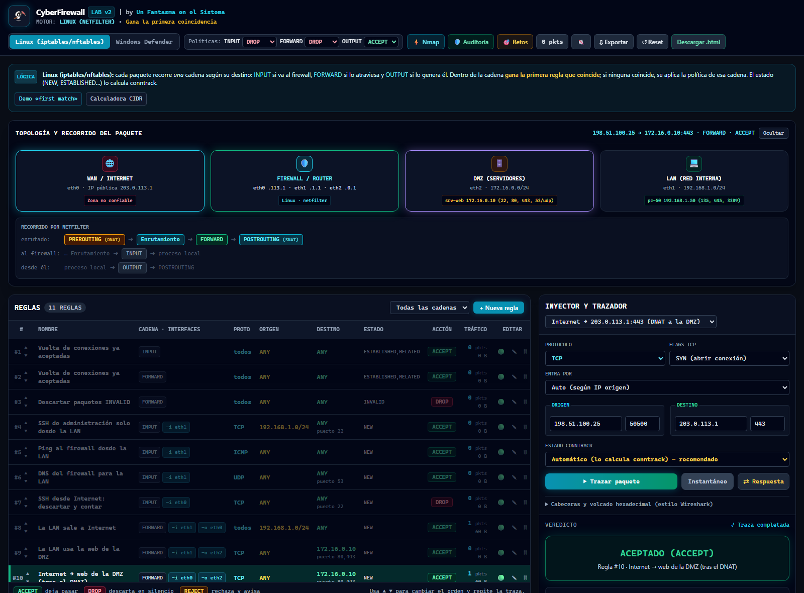
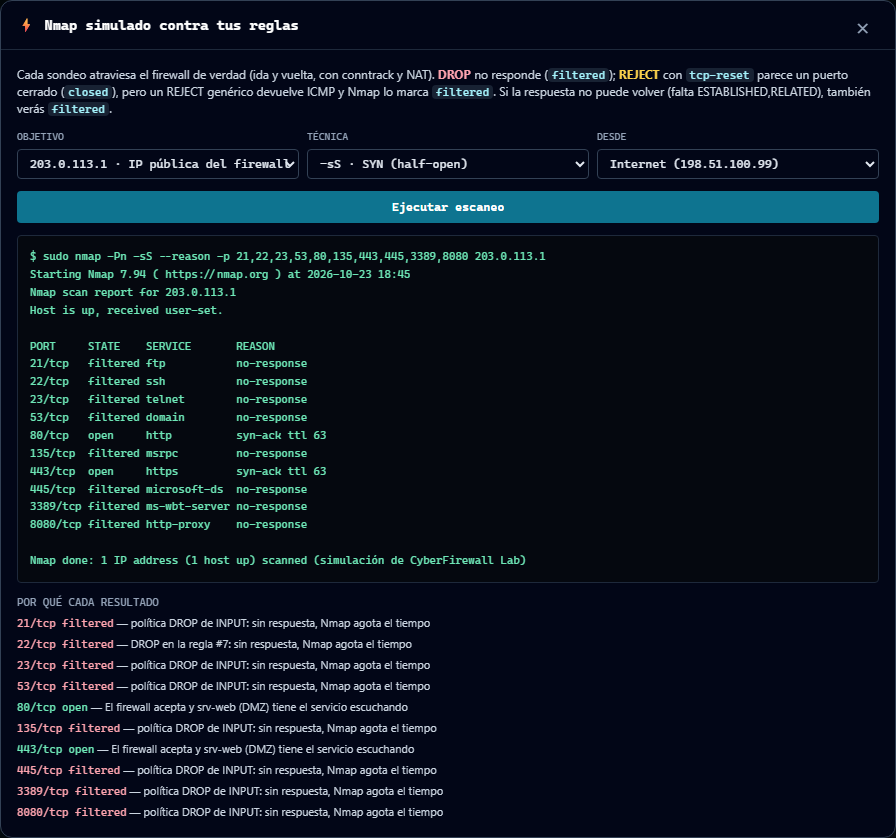
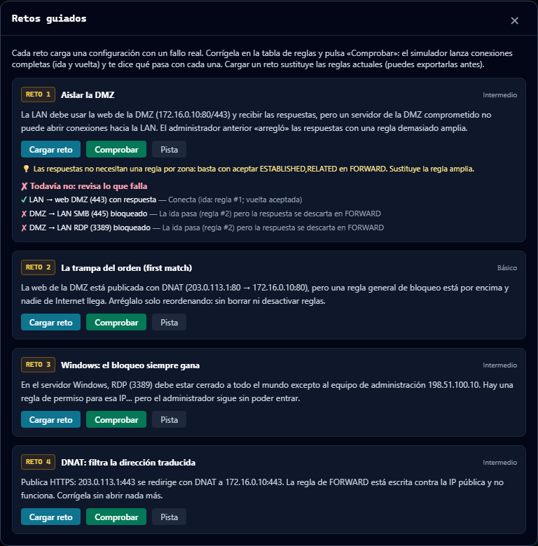
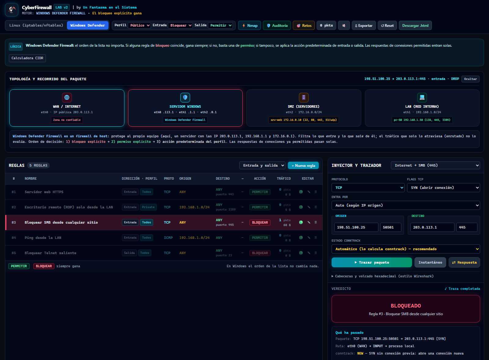

<p align="center">
  <a href="https://www.unfantasmaenelsistema.com"></a>
</p>

<h1 align="center">CyberFirewall Lab</h1>

<p align="center">
  <b>Simulador de firewalls que funciona en el navegador</b><br>
  iptables/nftables con cadenas, conntrack y NAT reales · Windows Defender Firewall · Nmap simulado · Reglas exportables
</p>

<p align="center">
  <a href="https://unfantasmaenelsistema.github.io/CyberFirewall-Lab/"><b>▶ Abrir el laboratorio</b></a> ·
  <a href="#qué-hace">Qué hace</a> ·
  <a href="#retos">Retos</a> ·
  <a href="#comprobado-contra-nmap-real">Comprobado contra Nmap real</a> ·
  <a href="#para-clase">Para clase</a> ·
  <a href="https://www.unfantasmaenelsistema.com">unfantasmaenelsistema.com</a> ·
  <a href="LICENSE">MIT</a>
</p>

<p align="center">
  
  
  
  
  
</p>

<p align="center">
  
</p>

Monta reglas, lanza paquetes y mira **por qué** el firewall los deja pasar o no: por qué interfaz entran, qué cadena recorren, qué estado les da conntrack, qué NAT se les aplica y qué regla decide. Todo pasa en tu navegador: no hay servidor, no se envía nada a ningún sitio y se puede descargar en un único `.html` para usarlo sin conexión.

> [!NOTE]
> Es un simulador educativo con una red fija (WAN, LAN y DMZ). Las reglas que exporta son reales y están probadas, pero revísalas y adapta las interfaces antes de aplicarlas en un equipo de verdad: un firewall mal configurado te puede dejar sin acceso.

## Qué hace

- **Red de tres patas**: Internet por `eth0` (IP pública 203.0.113.1), LAN `192.168.1.0/24` por `eth1` y DMZ `172.16.0.0/24` por `eth2`, con un servidor web en la DMZ y un PC en la LAN que tienen servicios escuchando.
- **Cadenas de verdad**: la cadena no se elige, se deduce de las IP como hace el kernel. Va al firewall → `INPUT`; lo atraviesa → `FORWARD`; lo genera él → `OUTPUT`. Cada cadena tiene su política (DROP/ACCEPT).
- **conntrack automático**: el estado (NEW, ESTABLISHED, RELATED, INVALID) lo calcula el simulador igual que `nf_conntrack`, incluida la rareza de `tcp_loose` (un ACK suelto entra como NEW). Puedes forzarlo a mano para experimentar, pero te avisa de que eso no pasa en la realidad.
- **NAT**: DNAT de puertos publicados en `PREROUTING` y MASQUERADE en `POSTROUTING`. El botón **⇄ Respuesta** prepara el paquete de vuelta tal como llega de Internet (a la IP pública) para ver cómo conntrack deshace el NAT.
- **Trazador paso a paso**: resalta las reglas de la cadena una a una y explica por qué cada una coincide o no (`entrada por eth1 y el paquete entra por eth0`, `estado NEW no está en ESTABLISHED,RELATED`…).
- **Bytes reales**: cabeceras Ethernet, IPv4, TCP/UDP/ICMP con checksums correctos, opciones TCP de un SYN de Linux y volcado hexadecimal.
- **Windows Defender Firewall**: firewall de host con perfiles, entrada/salida, precedencia de bloqueo («el bloqueo explícito siempre gana») y respuestas permitidas por estado. Si el tráfico solo atraviesa el equipo, te dice que Windows no lo evalúa.
- **Nmap simulado** (`-sS`, `-sT`, `-sA`, `-sU`) que lanza cada sondeo por el firewall y su respuesta de vuelta: `open`, `closed`, `filtered`, `unfiltered` u `open|filtered`, con la columna `REASON` y una explicación por puerto.
- **Detección de reglas sombreadas, redundantes o anuladas** (con CIDR y rangos de puertos contenidos, no solo iguales).
- **Auditoría de buenas prácticas** que prueba conexiones contra tus reglas: políticas, vuelta de conexiones, LAN aislada de Internet y de la DMZ, gestión expuesta, INVALID…
- **Exporta** a `iptables` (.sh), `nftables` (.nft), PowerShell (`New-NetFirewallRule`) y `netsh`, y guarda/restaura en JSON (también los de la versión 1).
- **Registros** con el formato real de una regla `LOG` de iptables y de `pfirewall.log`.
- Se guarda solo en tu navegador (`localStorage`). Sin cookies, sin analítica, sin peticiones a terceros.

<p align="center">
  
</p>

## Cómo decide

| | Linux (iptables / nftables) | Windows Defender Firewall |
| :-- | :-- | :-- |
| Qué filtra | Lo que llega al equipo, lo que sale y lo que lo atraviesa | Solo lo que llega al equipo o sale de él |
| Orden | Importa: dentro de la cadena gana la primera regla que coincide | No importa: bloqueo explícito > permiso explícito > acción predeterminada |
| Si nada coincide | Política de la cadena (`-P INPUT DROP`…) | Acción predeterminada de entrada o salida del perfil |
| Respuestas | Hace falta una regla `ESTABLISHED,RELATED` en cada cadena | Se permiten solas si la conexión se permitió |
| Rechazo | `DROP` calla; `REJECT` responde (RST solo con `-p tcp --reject-with tcp-reset`) | Bloquear siempre descarta en silencio |

## Retos

<p align="center">
  
</p>

Cada reto carga una configuración con un fallo real y la comprueba lanzando conexiones completas (ida y vuelta):

1. **Aislar la DMZ**: las respuestas funcionan gracias a una regla demasiado amplia que deja a un servidor comprometido llegar a la LAN.
2. **La trampa del orden**: la web publicada no se ve desde Internet porque un bloqueo general está por encima. Solo se puede arreglar reordenando.
3. **Windows: el bloqueo siempre gana**: hay un permiso para el equipo de administración, pero un bloqueo general lo anula.
4. **DNAT: filtra la dirección traducida**: la regla de `FORWARD` está escrita contra la IP pública y el paquete ya llega con la de la DMZ.

## Comprobado contra Nmap real

El simulador no se ha dado por bueno a ojo. En [`tests/real-lab`](tests/real-lab) hay un laboratorio que monta la misma red con *namespaces* de Linux (firewall de tres interfaces, Internet, LAN y DMZ con los mismos servicios escuchando), aplica las reglas que **exporta la app** y lanza **Nmap 7.99** de verdad desde cada zona. Después compara puerto a puerto con lo que predice el simulador:

- **60 de 60** puertos con el mismo estado en siete escaneos (`-sS`, `-sA` y `-sU`, desde Internet, la LAN y la DMZ).
- **57 de 60** también con el mismo motivo (`REASON`). Las tres diferencias son puertos rechazados con ICMP en los que el kernel no llegó a enviar todos los avisos porque limita cuántos ICMP manda por segundo (`net.ipv4.icmp_ratelimit`). El simulador lo explica en esos puertos.

```bash
node tests/real-lab/gen.js
sudo bash tests/real-lab/lab.sh
python3 tests/real-lab/compare.py
```

Además, las reglas exportadas se aplican en cada cambio con `iptables` y `nft -c` reales en GitHub Actions, y el script de PowerShell pasa la validación de parámetros con `-WhatIf`.

## Para clase

- **Sin instalar nada**: abre el [enlace](https://unfantasmaenelsistema.github.io/CyberFirewall-Lab/) o pulsa **Descargar .html** y reparte ese archivo: funciona sin conexión.
- **Guarda y comparte configuraciones** con **Exportar → .json**. Al importar se valida todo (IP, puertos, cadenas…) y los nombres se tratan como texto, así que un JSON malicioso no ejecuta nada.
- **Ideas de práctica**: que expliquen con el trazador por qué una respuesta entra sin regla propia; que publiquen un servicio nuevo en la DMZ (DNAT + FORWARD) y lo verifiquen con Nmap; que comparen un `DROP` y un `REJECT` desde fuera; que pasen la auditoría con un 100.

<p align="center">
  
</p>

## Usarlo en local

No necesita compilación ni servidor:

```bash
git clone https://github.com/unfantasmaenelsistema/CyberFirewall-Lab.git
```

Abre `index.html` con el navegador. Si prefieres servirlo:

```bash
python3 -m http.server 8080
```

### Desarrollo

```text
index.html          interfaz
js/engine.js        motor (sin DOM): topología, conntrack, NAT, reglas, Nmap, exportadores, retos
js/app.js           pantalla
css/src.css         estilos fuente (Tailwind 3)  →  css/app.css compilado
tests/              pruebas del motor (node --test) y laboratorio real con Nmap
```

```bash
npm ci          # solo hace falta para recompilar el CSS
npm test        # pruebas del motor
npm run css     # recompila css/app.css tras tocar clases
```

## Cambios

### 2.0 (2026-10-23)

Reescritura completa tras revisar la primera versión, que nació en Google AI Studio:

- La cadena y la interfaz ya no se eligen a mano: se deducen de las IP. Antes, por ejemplo, un cliente de la LAN visitando la DMZ se evaluaba en `INPUT` y el script exportado generaba `iptables -A INPUT -i eth2 -d 172.16.0.10`, que nunca filtra ese tráfico.
- conntrack calcula el estado. La regla de vuelta por defecto solo existía en `INPUT`, así que las respuestas a la LAN se habrían perdido en `FORWARD`.
- NAT corregido: antes se «enmascaraba» el tráfico LAN → DMZ (que no sale por `eth0`) y se consideraba privada cualquier `172.2x.x.x`. Ahora hay DNAT y MASQUERADE de verdad, y el puerto solo cambia si hay colisión.
- Nmap fiel: un REJECT sin `tcp-reset` ya no aparece como `closed`; `-sA` devuelve `unfiltered`/`filtered`; `-sU` escanea UDP; se tiene en cuenta si la respuesta puede volver.
- Exportadores que funcionan: PowerShell generaba `-Profile All` y `-Protocol ICMP` (inválidos), cruzaba local y remoto en las reglas de salida y nftables perdía las reglas de `FORWARD` y `OUTPUT`.
- Sin XSS al importar JSON o al escribir nombres de regla, con política de seguridad de contenidos (CSP).
- Sin dependencias en tiempo de ejecución: fuera la CDN de Tailwind y Google Fonts (el «offline» de la v1 no lo era), el logo roto en GitHub Pages y el andamiaje de AI Studio (Gemini, Vite, Express) que no se usaba.
- Nuevo: retos que se verifican con conexiones reales, auditoría funcional, disector con bytes y checksums reales, modo Windows con perfiles y estado, registros con formato real, persistencia local y versión de archivo único.
- Licencia MIT, como el resto de proyectos de la organización.

### 1.0

Versión inicial generada con Google AI Studio.

## Créditos y licencia

Hecho por **[Un Fantasma en el Sistema](https://www.unfantasmaenelsistema.com/)**. Código abierto bajo licencia [MIT](LICENSE).

Las direcciones del laboratorio son de documentación (RFC 5737: `203.0.113.0/24`, `198.51.100.0/24`) o privadas (RFC 1918).
